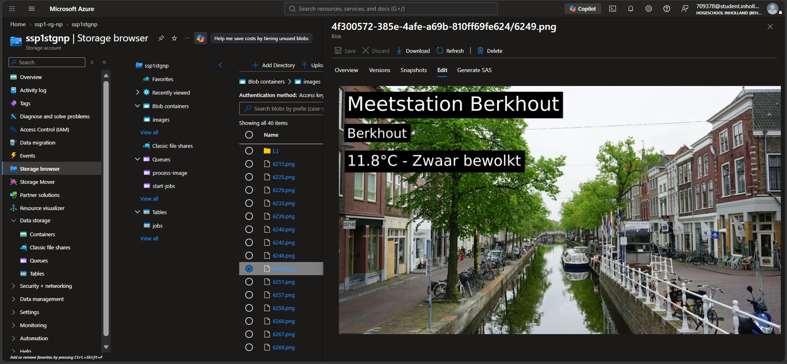
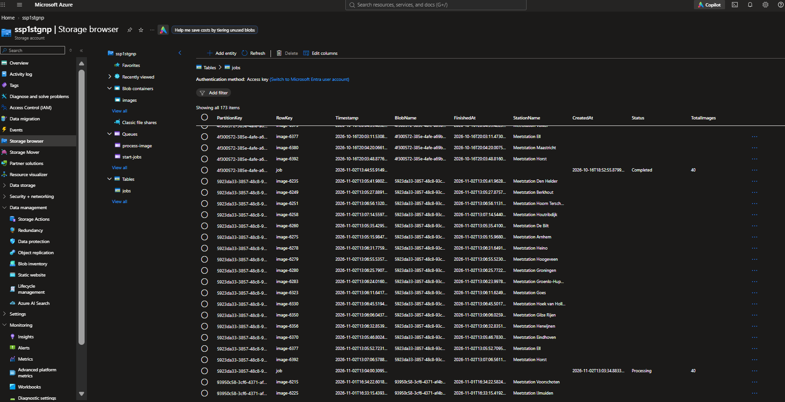

# SSP1 – Weather Images

One API call starts a background process that fetches weather data from Buienradar, takes a photo from Unsplash
for every weather station, writes the weather on it and stores the result in Azure Blob Storage.

**Live API:** https://ssp1-api-np.orangecoast-8d2a12d9.swedencentral.azurecontainerapps.io (try it with `api/api.http`).
The app is scalable: the API and jobs scale up automatically when there is more work, and scale down to zero when there is none to save costs.
Because of this, the first request after a quiet period can take a few seconds while the API starts up again.

## How it works

```
POST /jobs ──► [queue: start-jobs] ──► fetch-weather-job
                                          │ Buienradar → 1 message per station (max 50)
                                          ▼
                                   [queue: process-image] ──► process-image-job (1 run per station)
                                                                 │ Unsplash photo + weather text
                                                                 ▼
                                                          [blob: images/{jobId}/{stationId}.png]
GET /jobs/{jobId}         → status + progress (Table storage)
GET /jobs/{jobId}/images  → SAS links to the images
```

| Project | What it does |
| --- | --- |
| `api` | Minimal API: starts jobs, returns status and image links. |
| `fetch-weather-job` | Reads `start-jobs`, fetches Buienradar data, fans out one message per station to `process-image`. |
| `process-image-job` | Reads `process-image`, gets a photo (searched by the station's region), writes the weather on it, uploads it. |
| `Shared` | `Storage.cs` (queue/blob/table clients) and the models `WeatherStation`, `ImageJobMessage`, `JobStatus`. |
| `infra` | Bicep templates for all Azure resources. |

A queue message is only deleted **after** the work succeeded; if a run crashes, the message reappears and is retried.
In Azure both jobs are **event-triggered Container Apps Jobs**: they start automatically when a message lands on their queue.

## API endpoints

| Method | Endpoint | Description |
| --- | --- | --- |
| `GET` | `/` | Shows that the API is running and lists the endpoints. |
| `POST` | `/jobs` | Starts a job, returns `202 Accepted` with the `jobId`. |
| `GET` | `/jobs/{jobId}` | Status (`Queued`, `Processing`, `Completed`) and progress. `404` for an unknown job. |
| `GET` | `/jobs/{jobId}/images` | SAS link for every image finished so far. `404` for an unknown job. |

All requests are in `api/api.http`; request 1 stores the `jobId` that requests 2 and 3 use.

**Note:** the API scales to zero when it is not used, so the **first request can take several seconds** while it starts up (also when simply opening the API URL in a browser).
After starting a job it also takes a few minutes before all images are ready; the status endpoint shows the progress,
and the images endpoint returns the images finished so far.

## Design decisions

### Architecture

Three separate programs in their own containers that only communicate through **two queues**. Patterns used:
**asynchronous request-reply** (`202` now, status later), **event-driven** (a queue message starts the next step),
**fan-out** (one job → one message per station, processed in parallel), **queue-based load leveling** and **scale to zero**.

**Scalability:** every part scales on its own. The API runs 0 to 2 instances depending on traffic, the fetch job up to 5 runs
and the image job up to 10 runs at the same time, depending on how many messages are waiting. These limits are set in Bicep
and can simply be raised for more load.

It has microservice traits (separate containers, one responsibility each, independent scaling), but the services share one
storage account, one table and the `Shared` project, and are deployed together. So it is best described as an
**event-driven, queue-based background processing system** rather than strict microservices.

### The trigger

The trigger is not in the C# code; it is set up in the Bicep template of the jobs (`jobs.bicep`).
Both jobs are event-triggered, and **KEDA** (built into Azure Container Apps) watches their queue using the job's managed identity.
Every 10 seconds it checks for messages and starts one run per message: at most 10 image runs at the same time
(5 for the fetch job), and nothing at all when the queue is empty. Each run handles one message and stops.
Locally I started the jobs by hand instead. In the Azure portal the trigger is visible under the job's
**Event-driven scaling** settings, and every run under **Execution history**.

### Table storage: `jobs`

| PartitionKey | RowKey | Written by | Columns |
| --- | --- | --- | --- |
| job id | `job` | api → fetch-weather-job → api | `Status` (`Queued` → `Processing` → `Completed`), `TotalImages`, `CreatedAt` |
| job id | `image-{stationId}` | process-image-job | `StationName`, `BlobName`, `FinishedAt` |

- **The job id is a GUID** (a random unique id): it is unique without looking anything up in a database,
  it cannot be guessed like 1, 2, 3 could, and because it is random it spreads the jobs evenly.
- **PartitionKey = job id, so there is no hotspot.** Using one fixed key for every row, or the date, would send all traffic
  to a single partition, which is served by one server. With the job id every job gets its own partition,
  while all rows of one job stay together, so the status query only has to look inside that one job.
- **RowKey:** the status row always has the fixed name `job`, so the API can read it directly by its two keys without searching.
  Every image row is named after its station, which is unique within a job. If a run is retried, it overwrites
  its own row instead of adding a new one, so an image is never counted twice. One table with two kinds of rows keeps a whole job in one partition.
- **`Completed` is calculated by the API**, not written by the image jobs: up to 10 run in parallel and none knows if it is the last.
  When the `image-…` rows reach `TotalImages`, the status request saves `Completed` once to the job row.

### Security

- **No storage keys anywhere:** in Azure the API and jobs log in to storage with their own **managed identity**,
  which has only the rights it needs on the queues, blobs and table. Locally the same code connects to Azurite instead;
  `Shared/Storage.cs` decides which one to use, so nothing has to change between local and Azure.
- **Private blob container + SAS links:** the images cannot be opened with a plain URL. The API hands out links that are
  read-only, work for one image only, expire after 1 hour, and only for images of that job.
  In Azure these links are signed with a temporary key the API requests with its managed identity.
- **Container registry:** the admin login is turned off; the apps pull their images with a separate managed identity.
- **Secrets stay out of Git:** the Unsplash key is passed in during deployment and stored as a secret in Azure and in GitHub.
  GitHub Actions logs in to Azure without a stored password.

## Testing

Everything was first built and tested locally with **Azurite** (local Azure Storage emulator) and **Azure Storage Explorer**:
both queues (create, read, delete, fan-out), the blob upload, the table rows and progress (for example 3 of 40, 7%), and the SAS links
(the same URL without the token is refused, because the container is private). After deploying, the same flow was tested in Azure
with `api/api.http` and checked in the Azure portal.

**Local:**


**Azure:**




## Deployment

`deploy.ps1` deploys everything in two phases: first the storage (queues, blob container, table) and the container registry
with Bicep, then it builds the 3 projects as container images with the dotnet CLI and pushes them, and finally deploys the
Container Apps environment, the API and the two jobs with Bicep. Two phases are needed because the apps need the images,
and the images need the registry. No Docker is needed.

| Bicep file | Resources |
| --- | --- |
| `main.bicep` | Parameters, names, modules |
| `modules/storage.bicep` | Storage account, `images` container, `start-jobs` + `process-image` queues, `jobs` table |
| `modules/containerRegistry.bicep` | Registry (Basic, admin off) + pull identity |
| `modules/containerAppsEnvironment.bicep` | Log Analytics + environment (workload profiles, Consumption) |
| `modules/api.bicep` | API container app (public HTTPS) + role assignments |
| `modules/jobs.bicep` | Two queue-triggered jobs + role assignments + Unsplash secret |

### GitHub Actions

Every push to `master` runs the same `deploy.ps1` automatically (documentation-only changes are skipped).
GitHub logs in to Azure without a stored password, through a managed identity that trusts this repository.
The Azure ids and the Unsplash key are stored as GitHub secrets.

## Notes

- **Station count:** Buienradar returns around 40–43 stations, not exactly 50, so the app uses **at most 50**.
- **Missing weather data:** some stations (for example at sea, such as 6225) send no temperature or description.
  Only the available data is written, or "Geen weerdata beschikbaar" when there is none.
- **Unsplash limit:** 50 requests per hour, so a second job in the same hour is refused by Unsplash. Those messages stay on the
  queue and are retried after the limit resets.
- **Regions:** storage, registry and logs are in Germany West Central; the Container Apps are in **Sweden Central**,
  because Germany West Central had no capacity for a new Container Apps environment.
- **Environment mode:** the Container Apps environment must use workload profiles; the default "Express" mode does not support jobs.
- **No Dockerfiles:** building images in Azure is blocked on the student subscription, so the .NET SDK builds them instead.
  `process-image-job` includes its own font, because the Linux container has no fonts.
- **ImageSharp 3.1.12 / Drawing 2.1.7** are pinned (same as the course sample). NuGet warns about security advisories in all 3.x versions;
  the 4.x versions fix them but need a paid license and break the text drawing code. The risk is low: only trusted Unsplash photos are processed.
- **Not implemented:** authentication on the API (Could). The images are still protected by the private container and SAS links.

## Course material used

- `ImageHelper.cs` is based on the [ImageEditor sample](https://github.com/wearetriple/InHolland-CCD/tree/main/2026/samples/ImageEditor),
  extended with a dark background behind the text and a bundled font.
- The SAS endpoint is based on `ImagesController` from the [DemoImagesApi demo](https://github.com/wearetriple/InHolland-CCD/tree/main/2026/demos/src/DemoImagesApi).
- Following the course guidance: no account keys in Bicep or Git.

## AI usage

**Claude (Opus 5.5)** was used inside a Claude project with the assignment brief and course slides, for code suggestions
(which I added myself), explanations, splitting the work into small steps, understanding errors, the Bicep/deploy/GitHub Actions
setup and the Azure deployment errors, and organizing this README.

I did not let the AI build everything at once: I worked in small steps, tested every step locally, ran every deployment myself,
checked the results in the Azure portal and with `api.http`, and reviewed the code and made my own choices along the way.