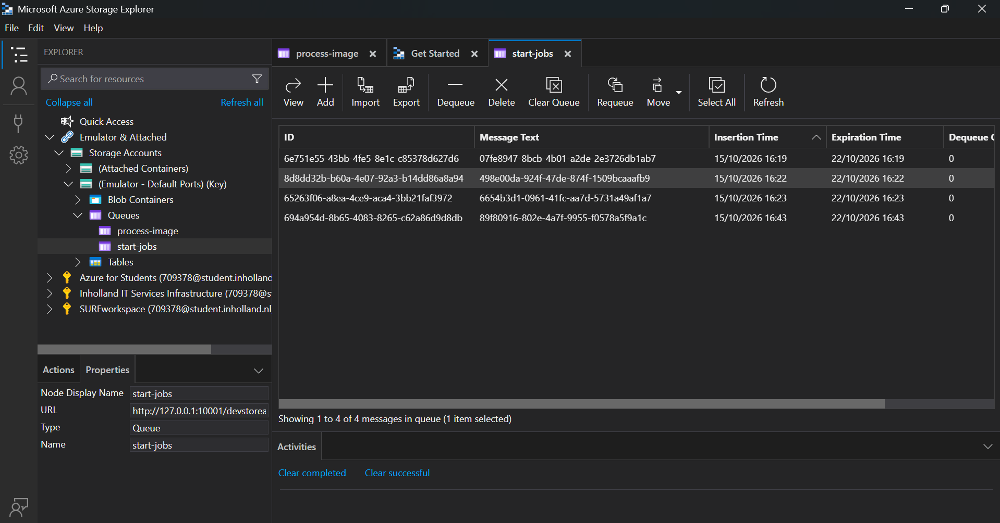
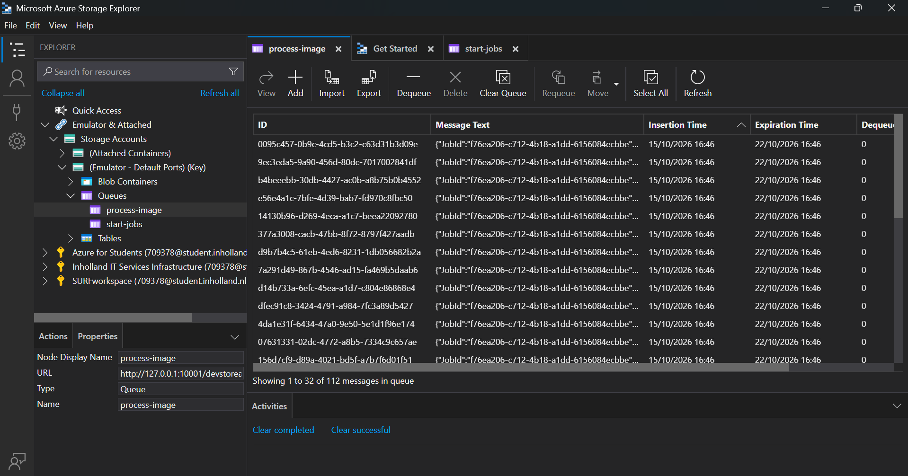
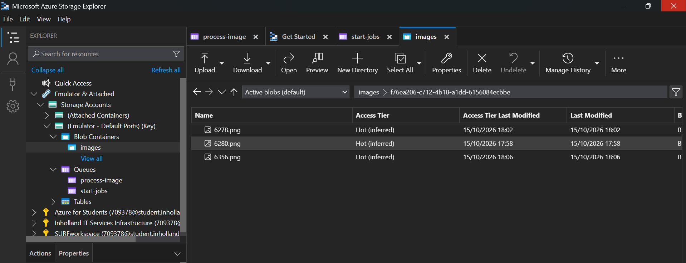
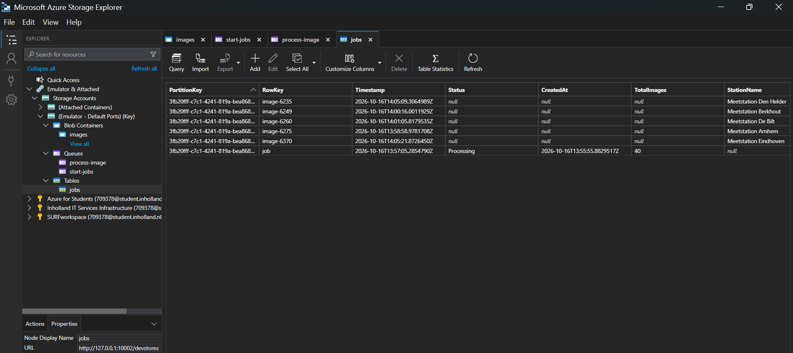

# SSP1 – Weather Images

An app that generates images with current weather data for Dutch weather stations.
A single API call starts a background process: weather data is fetched from Buienradar,
and for each weather station a photo is taken from Unsplash, the weather data is written
on it, and the result is stored in Azure Blob Storage.

**Live API:** https://ssp1-api-np.orangecoast-8d2a12d9.swedencentral.azurecontainerapps.io
(try it with `api/api.http`)

## How it works

```
POST /jobs
   │  writes job row (Queued) to table "jobs"
   ▼
[queue: start-jobs] ──► fetch-weather-job
                            │  fetches Buienradar data
                            │  sets job to Processing + TotalImages
                            │  sends 1 message per station (max 50)
                            ▼
                     [queue: process-image] ──► process-image-job (1 run per station)
                                                   │  gets a photo from Unsplash
                                                   │  writes the weather data on it
                                                   │  adds an "image" row to table "jobs"
                                                   ▼
                                            [blob container: images]
                                              {jobId}/{stationId}.png
                                                   │
                                                   ▼
                     GET /jobs/{jobId}          (status + progress)
                     GET /jobs/{jobId}/images   (SAS links)
```

| Project | What it does |
| --- | --- |
| `api` | Web API. `POST /jobs` returns a job id immediately (202 Accepted) and puts the job on the `start-jobs` queue. `GET /jobs/{jobId}` returns the status and progress. `GET /jobs/{jobId}/images` returns temporary SAS links to the finished images. |
| `fetch-weather-job` | Reads one message from `start-jobs`, fetches weather data from Buienradar and fans out one message per station to `process-image`. |
| `process-image-job` | Reads one message from `process-image`, gets a photo from Unsplash (searched by the station's region), writes the weather data on it and uploads it to Blob Storage. |
| `Shared` | Code used by more than one project: `Storage.cs` (creates the queue, blob and table clients) and the models `WeatherStation`, `ImageJobMessage` and `JobStatus`. |
| `infra` | Bicep templates for all Azure resources. |

Every message is only deleted from its queue **after** the work has succeeded.
If a job crashes, the message becomes visible again and is retried.

In Azure, both jobs are **Container Apps Jobs with an event trigger**: they start automatically
when a message lands on their queue (KEDA `azure-queue` scaler), handle one message and stop.

## API endpoints

| Method | Endpoint | Description |
| --- | --- | --- |
| `POST` | `/jobs` | Starts a new job. Returns `202 Accepted` with the `jobId`. The work happens in the background. |
| `GET` | `/jobs/{jobId}` | Status and progress of the job (`Queued`, `Processing`, `Completed`). Returns `404` for an unknown job. |
| `GET` | `/jobs/{jobId}/images` | A SAS link to every image of the job that is finished so far. Returns `404` for an unknown job. |

All requests are documented in `api/api.http`. Run them in order: request 1 starts a job and
stores the `jobId`, which requests 2 and 3 use automatically.

Example status response:

```json
{
  "jobId": "3f2a...",
  "status": "Processing",
  "totalImages": 42,
  "finishedImages": 17,
  "progressPercent": 40,
  "createdAt": "2026-10-16T21:40:00Z"
}
```

### Job status in Table storage

The table `jobs` uses the **job id as PartitionKey**, so all rows of one job are stored together:

| RowKey | Written by | Contents |
| --- | --- | --- |
| `job` | api, fetch-weather-job, then api again | `Status` (`Queued` → `Processing` → `Completed`), `TotalImages`, `CreatedAt` |
| `image-{stationId}` | process-image-job | `StationName`, `BlobName`, `FinishedAt` (one row per finished image) |

The progress is calculated by counting the `image-…` rows. `Completed` is **calculated by the API** and saved to
the job row the first time the API sees that all images are finished (the number of `image-…` rows reaches `TotalImages`).

This way the many parallel `process-image-job` runs never have to update the same row: none of them knows whether
it is the last one, so they only add their own `image-…` row. The status request is the only place that writes `Completed`.

### Image links with SAS tokens

The `images` blob container is **private**: the images cannot be opened with a plain URL.
Instead, `GET /jobs/{jobId}/images` creates a **SAS (Shared Access Signature) link** for every image:

- **Read-only** – the link can only be used to view the image
- **One blob only** – the link works for that single image, not the whole container
- **Valid for 1 hour** – after that the link stops working

Only blobs whose name starts with `{jobId}/` are returned, so every job only sees its own images.
The endpoint returns the images that are finished **so far**, so calling it while the job is still running gives a partial list.

Locally (Azurite) the SAS is signed with the account key. In Azure there is no account key in the app:
the API uses its managed identity to get a **user delegation key** and signs the SAS with that.

## Security

- **No storage keys anywhere.** In Azure, the API and both jobs use a **managed identity** with
  role assignments (Queue, Blob and Table Data Contributor) on the storage account.
- **Container registry** has the admin user disabled; images are pulled with a separate managed identity (`AcrPull`).
- **The Unsplash key** is never in code or Git. It is passed to the deployment as a `@secure()` Bicep parameter
  and stored as a **Container Apps secret**. In GitHub it is a repository secret.
- **GitHub Actions** logs in to Azure with **OIDC** (federated credential), so there is no password or client secret stored in GitHub.

### Local vs. Azure storage connection

`Shared/Storage.cs` decides which storage to use:

- **`STORAGE_ACCOUNT_NAME` not set** → Azurite (`UseDevelopmentStorage=true`)
- **`STORAGE_ACCOUNT_NAME` set** (done by Bicep in Azure) → the real storage account, with `DefaultAzureCredential` (managed identity)

So the same code runs locally and in Azure without changes.

## Design decisions

### Architecture: event-driven, queue-based background workers

The app is split into three separate programs (`api`, `fetch-weather-job`, `process-image-job`), each in its own container.
They never call each other directly; they only communicate through queues.

| Pattern | Where it is used |
| --- | --- |
| **Asynchronous request-reply** | `POST /jobs` answers immediately with `202 Accepted`; the client checks progress later with `GET /jobs/{jobId}`. The slow work never blocks the API call. |
| **Event-driven** | A message on a queue (the event) automatically starts the next step. |
| **Fan-out** | One message on `start-jobs` becomes one message per station on `process-image`, so the images are made in parallel. |
| **Queue-based load leveling** | The queues hold the work, so a burst of requests does not overload anything; the jobs work through it at their own pace. |
| **Scale to zero** | Nothing runs (and nothing costs money) when there is no work. |

**Is it microservices?** It has some microservice traits: separate containers with one responsibility each,
communicating through queues and scaling independently. But all three share one storage account and the same
`jobs` table, share code through the `Shared` project and are deployed together. Classic microservices each own
their own data and are deployed independently. So it is best described as an **event-driven, queue-based background processing system**.

### Where the trigger happens

The trigger is not in the C# code; it is configured in `infra/modules/jobs.bicep` and executed by Azure Container Apps:

```bicep
triggerType: 'Event'
eventTriggerConfig: {
  scale: {
    minExecutions: 0          // empty queue -> nothing runs
    maxExecutions: 10         // at most 10 runs at the same time (5 for the fetch job)
    pollingInterval: 10       // check the queue every 10 seconds
    rules: [
      {
        type: 'azure-queue'   // KEDA queue scaler
        metadata: { queueName: 'process-image', queueLength: '1' }  // 1 run per message
        identity: 'system'    // reads the queue with the job's managed identity
      }
    ]
  }
}
```

**KEDA** (built into Container Apps) checks both queues every 10 seconds. When it sees messages, it starts
job runs (one per message, up to the maximum). Each run handles one message and stops. Locally this step was done
by hand with `dotnet run`; in Azure, KEDA does it.

The trigger settings can be seen in the portal under the job → **Event-driven scaling**, and every run under **Execution history**.

### Job id: a GUID

`POST /jobs` creates the job id with `Guid.NewGuid()`. A **GUID** (Globally Unique Identifier, also called UUID)
is a random 128-bit id, for example `fd03a386-195f-4626-9991-c782ebbb62bd`. I chose a GUID because:

- **Unique without checking** – there are about 5 × 10³⁶ possible GUIDs, so the API does not need a database lookup for the next free number.
- **Not guessable** – with ids like 1, 2, 3 anyone could try `/jobs/4` to see someone else's job; a random GUID cannot be guessed.
- **Random** – this spreads the jobs evenly over the partitions in Table storage (see below).

### PartitionKey = job id (no hotspot)

Every row in Table storage has a **PartitionKey** (groups related rows together) and a **RowKey** (identifies one row inside that group).
In the `jobs` table the PartitionKey is the job id and the RowKey is `job` or `image-{stationId}` (see [Job status in Table storage](#job-status-in-table-storage)).

Azure serves each partition from one server, which handles about 2,000 operations per second.
A **hotspot** is one partition that gets almost all the traffic and becomes the bottleneck. Choices that would cause one:

- a **fixed PartitionKey** such as `"jobs"` – every job in one partition, everything through one server;
- the **date** such as `"2026-10-19"` – all jobs of today in the same partition.

With the job id (a random GUID) as PartitionKey:

- **No hotspot** – every job gets its own partition, so many jobs at the same time are spread over many partitions.
- **Fast lookups** – `GET /jobs/{jobId}` reads the row `(jobId, "job")` directly by its two keys, the fastest lookup Table storage has.
- **Counting stays inside one job** – the query `PartitionKey eq {jobId} and RowKey ne 'job'` only searches the rows of that one job.
- **No write conflicts** – each `process-image-job` run writes its own `image-{stationId}` row, so parallel runs never overwrite each other.

Inside one job all writes do go to the same partition, but that is only about 41 rows within a few minutes,
far below the limit, and keeping them together is exactly what makes the status query fast.

### RowKey = `job` or `image-{stationId}`

The RowKey identifies one row inside a job's partition. PartitionKey + RowKey together must be unique.

| RowKey | Meaning | Example |
| --- | --- | --- |
| `job` | The single status row of the job (`Status`, `TotalImages`, `CreatedAt`) | `job` |
| `image-{stationId}` | One row per finished image (`StationName`, `BlobName`, `FinishedAt`) | `image-6260` |

Why I chose these RowKeys:

- **A fixed name for the status row** – because the status row is always called `job`, the API can read it directly
  with `(jobId, "job")` without searching. That is the fastest possible lookup (a "point query").
- **The station id makes every image row unique** – each weather station appears only once per job,
  so `image-{stationId}` can never collide with another image of the same job.
- **Safe retries (idempotent)** – if a `process-image-job` run crashes after writing its row and the message is retried,
  it writes the same RowKey again (`UpsertEntityAsync`) instead of adding a duplicate. So an image is never counted twice.
- **Easy to tell apart** – the status row is excluded from the count with `RowKey ne 'job'`, so every other row in the partition is a finished image.
- **The prefix `image-`** makes it clear what kind of row it is, and leaves room for other row types later
  (for example `error-{stationId}`) without changing the table.

Using one table with two kinds of rows (instead of a separate `images` table) keeps all data of one job in one partition,
so the status and progress come from a single query.

### `Completed` is calculated, not written by the image jobs

Up to 10 `process-image-job` runs work at the same time, and none of them knows whether it is the last one.
If they had to update a shared counter or write `Completed` themselves, two runs finishing at the same moment could
both miss it or overwrite each other. Instead, each run only adds its own `image-…` row, and the API decides:
when the number of `image-…` rows reaches `TotalImages`, the job is `Completed`. The API then saves `Completed`
to the job row once, so Table storage shows the final status too.

### Security choices

- **Managed identities instead of keys** – no storage account key in code, Bicep or Git (following the course guidance).
- **Private blob container + SAS links** – images are only reachable through read-only links for one blob, valid for one hour.
  In Azure these are signed with a user delegation key, so no account key is needed there either.
- **Secrets stay out of Git** – the Unsplash key is a `@secure()` Bicep parameter, a Container Apps secret and a GitHub secret.

## Running locally

Requirements:

- .NET 10 SDK
- [Azurite](https://learn.microsoft.com/en-us/azure/storage/common/storage-use-azurite) (VS Code extension).
  Turn on the setting **Azurite: Skip Api Version Check**, otherwise the newest storage SDK is refused.
- An Unsplash developer account (access key)

Steps:

```powershell
# 1. Start Azurite in VS Code: Ctrl+Shift+P → "Azurite: Start"

# 2. Start the API
dotnet run --project api

# 3. Start a job: run request 1 in api/api.http

# 4. Run the jobs by hand (in Azure this happens automatically)
dotnet run --project fetch-weather-job

$env:UNSPLASH_ACCESS_KEY = "<your Unsplash access key>"
dotnet run --project process-image-job   # handles one message per run
```

### What was tested locally

All storage parts of this project were developed and tested locally before deploying to Azure, using:

- **Azurite** (VS Code extension) – local emulator for Azure Storage (Blob, Queue and Table)
- **Microsoft Azure Storage Explorer** – to inspect queues, messages, blobs and table rows

What was tested:

- **Queue `start-jobs`** – `POST /jobs` creates a message with the job id; `fetch-weather-job` receives it and deletes it after processing.
- **Queue `process-image`** – `fetch-weather-job` creates one message per weather station (fan-out); `process-image-job` receives one message, processes it and deletes it.
- **Blob container `images`** – `process-image-job` uploads the generated image as `{jobId}/{stationId}.png`, viewable in Storage Explorer.
- **Table `jobs`** – the API creates the job row (`Queued`), fetch-weather-job sets `Processing` and `TotalImages`, and process-image-job adds one row per finished image. `GET /jobs/{jobId}` shows the progress (for example 3 of 40, 7%), and the job row changes to `Completed` once the status request sees all images.
- **SAS links** – `GET /jobs/{jobId}/images` returns a read-only link per image, valid for 1 hour. The same URL without the SAS token is refused with `AuthorizationFailure`, because the `images` container is private.

Screenshots:






## Deploying to Azure

### Requirements

- [Azure CLI](https://learn.microsoft.com/cli/azure/install-azure-cli) (with Bicep: `az bicep install`)
- .NET 10 SDK
- An Unsplash access key
- **Docker is not needed.** The container images are built and pushed by the dotnet CLI.

### Deploy

```powershell
az login
$env:UNSPLASH_ACCESS_KEY = "<your Unsplash access key>"
.\deploy.ps1
```

Optional parameters (use your own suffix to get unique resource names):

```powershell
.\deploy.ps1 -Suffix "xy" -Location "germanywestcentral" -AppsLocation "swedencentral" -UnsplashAccessKey "<key>"
```

At the end the script prints the API URL. Put it in `@baseUrl` in `api/api.http`.

### What `deploy.ps1` does

1. Checks the Azure login and registers the resource providers.
2. Creates the resource group `ssp1-rg-{suffix}`.
3. **Bicep phase 1** (`deployApps=false`): storage account (2 queues, blob container, table) and container registry.
4. Logs in to the container registry (`az acr login`, or a token login when Docker is not running).
5. Builds and pushes the 3 projects as container images with
   `dotnet publish /t:PublishContainer`, with a new UTC timestamp as image tag.
6. **Bicep phase 2** (`deployApps=true`): Container Apps environment, the API and the two jobs, using the new image tag.
7. Prints the API URL.

There are two phases because the apps can only be created after their images exist in the registry,
and the registry must exist before the images can be pushed.

### Azure resources (`infra/`)

| Bicep file | Resources |
| --- | --- |
| `main.bicep` | Parameters, names and the modules below |
| `modules/storage.bicep` | Storage account, blob container `images`, queues `start-jobs` and `process-image`, table `jobs` |
| `modules/containerRegistry.bicep` | Container registry (Basic, admin off) + pull identity with `AcrPull` |
| `modules/containerAppsEnvironment.bicep` | Log Analytics workspace + Container Apps environment (workload profiles, Consumption) |
| `modules/api.bicep` | The API container app (public HTTPS ingress) + storage role assignments |
| `modules/jobs.bicep` | The two queue-triggered Container Apps Jobs + storage role assignments + Unsplash secret |

## Build and deploy with GitHub Actions

`.github/workflows/deploy.yml` runs on every push to `master` (and by hand with **Run workflow**).
It installs .NET 10, logs in to Azure and runs the same `deploy.ps1`.
Changes to only the README, screenshots or `api.http` do not trigger a deploy.

### One-time setup

1. A user-assigned managed identity `ssp1-github-deploy-np` with the **Owner** role on the resource group
   (Owner is needed because the Bicep templates create role assignments).
2. A **federated credential** on that identity for the GitHub repo, so GitHub can log in without a password.
3. Repository secrets in GitHub (**Settings → Secrets and variables → Actions**):

| Secret | Value |
| --- | --- |
| `AZURE_CLIENT_ID` | client id of the managed identity |
| `AZURE_TENANT_ID` | tenant id |
| `AZURE_SUBSCRIPTION_ID` | subscription id |
| `UNSPLASH_ACCESS_KEY` | the Unsplash access key |

Note: GitHub sends the subject claim in the newer format that includes the numeric owner and repo ids
(`repo:nazpedawi@144240165/SSP1@1358243259:ref:refs/heads/master`). The federated credential must match this
exactly, otherwise the login fails with `AADSTS700213: No matching federated identity record found`.

The deploy identity only has rights on the resource group, so registering resource providers
(a subscription-level action) is skipped with a warning in the pipeline. The providers were already registered by the first local deploy.

## Notes

### Station count

The assignment brief references "50 weather stations", but Buienradar's live feed does not return a fixed number.
The actual count changes (stations can be offline for maintenance, etc.).
Observed live responses have ranged from around 40 to 43 stations rather than exactly 50.
The application therefore uses **at most 50** stations and processes however many the feed returns.

### Unsplash rate limit

An Unsplash demo app allows **50 requests per hour**. Every image needs one request, so one job uses almost
the whole hourly limit, and a second job in the same hour gets `403` errors from Unsplash.
Those messages are **not lost**: they stay on the `process-image` queue and are retried, so the
remaining images are made once the limit resets. A production app would need an approved Unsplash app (5000 requests per hour).

### Azure regions

The Azure for Students subscription only allows a few regions. Storage, the container registry and
Log Analytics are in **germanywestcentral**. The Container Apps environment, API and jobs are in **swedencentral**,
because creating the environment in germanywestcentral failed with `AKSCapacityHeavyUsage` (no capacity in that region).
Both regions are configurable in `deploy.ps1` (`-Location` and `-AppsLocation`).

### Container Apps environment mode

The environment is created with `environmentMode: 'WorkloadProfiles'` and a Consumption workload profile.
Without this, a new environment is created in **Express** mode, which does not support Container Apps Jobs
(`ExpressEnvironmentResourceNotSupported`).

### Container images without Dockerfiles

The student subscription does not allow ACR Tasks (`az acr build` fails with `TasksOperationsNotAllowed`).
The images are therefore built with the .NET SDK (`dotnet publish /t:PublishContainer`), which needs no Dockerfile and no Docker.
`process-image-job` includes the font `Fonts/DejaVuSans.ttf`, because the Linux container image has no system fonts.

### ImageSharp version

`SixLabors.ImageSharp` **3.1.12** and `SixLabors.ImageSharp.Drawing` **2.1.7** are pinned on purpose.
These are the same versions as the course sample in `InHolland-CCD/2026/samples/ImageEditor`.

When building, NuGet shows a warning that ImageSharp 3.1.12 has known security advisories.
This was investigated:

- **All 3.x versions** of ImageSharp (including the newer 3.2.0) are flagged with moderate and high severity advisories.
- Only the **4.x line** (4.1.2 and later) has the fixes, but together with ImageSharp.Drawing 3.x it:
  - requires a **commercial Six Labors license key** for Release builds (needed for the container image), and
  - has **breaking API changes** (`DrawText` no longer works as used in `ImageHelper.cs`).

Upgrading was tried, but it broke the build, so it was rolled back to the versions above.

**Why the risk is low:** the advisories are about processing malicious image files.
This app only processes photos downloaded from the Unsplash API (a trusted source), never images uploaded by users.

### Not implemented

- **Authentication on the API** (a Could requirement) was not implemented. The API endpoints are public.
  The images themselves are still protected: the blob container is private and only reachable through the time-limited SAS links.

## Troubleshooting

| Problem | Cause / fix |
| --- | --- |
| Azurite: `The API version ... is not supported` | Turn on **Azurite: Skip Api Version Check** and restart Azurite. |
| Images not visible in Storage Explorer | Refresh, or restart Azurite. |
| Table cannot be opened in the Azure portal | Use the Storage browser with **Access key** authentication, or give yourself the Storage Table Data Reader role. |
| `ExpressEnvironmentResourceNotSupported` | The environment was created in Express mode. Delete it and redeploy (the Bicep sets `WorkloadProfiles`). |
| `AKSCapacityHeavyUsage` | No Container Apps capacity in that region. Use another `-AppsLocation`. |
| `TasksOperationsNotAllowed` | ACR Tasks are blocked on the subscription; `deploy.ps1` already builds with the dotnet CLI instead. |
| `403` from Unsplash in the job logs | Hourly Unsplash limit reached. The messages are retried automatically after the limit resets. |
| `AADSTS700213` in GitHub Actions | The federated credential subject does not match the subject in the log. Add a credential with the exact subject. |

## Course material used

- `ImageHelper.cs` is based on the course sample
  ([wearetriple/InHolland-CCD/2026/samples/ImageEditor](https://github.com/wearetriple/InHolland-CCD/tree/main/2026/samples/ImageEditor)),
  extended with a semi-transparent dark background behind each line of text for readability and a bundled font.
- The SAS endpoint is based on `ImagesController` from the course demo
  (`InHolland-CCD/2026/demos/src/DemoImagesApi`), adapted to return only the images of one job.
- The Bicep setup follows the course guidance to not put account keys in Bicep or Git (managed identities instead).

## AI usage

**Claude (Opus 5.5)** was used during this assignment, inside a Claude project that contained the assignment brief and the course slides.

How it was used:

- suggesting code, which I added to the project myself.
- explaining what each piece of code does.
- splitting the assignment into small steps.
- understanding errors.
- helping with the Bicep templates, `deploy.ps1` and the GitHub Actions workflow, and with the Azure errors during deployment
  (regions, Express environment, ACR Tasks, the GitHub federated credential).
- organizing this README.

How I worked with it:

- I did not give the assignment to the AI and let it build everything at once, I asked to work in small steps instead.
- Every step was run and tested by me locally before moving on to the next one.
- I ran every deployment myself and checked the result in the Azure portal and with `api.http`.
- I reviewed the code in each step and made my own choices along the way.
